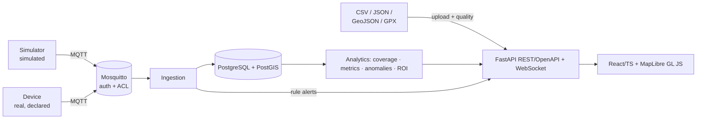

# AgroFleet Intelligence

**English** · [Português](README.md)

Telemetry, monitoring and auditing for agricultural machines, focused on **autonomous ground sprayers** (4+). It ingests what the machine *reports*, validates it, stores it, measures coverage and productivity, and raises **informational alerts**.

> **Scope and safety.** The system **does not control** steering, braking or spraying and **generates no machine commands**. Alerts are informational; critical decisions stay with certified systems and people.
>
> **Data honesty.** Every number in this repository comes from a **simulator** (`origin = simulated`), never from a real machine. Simulated and real data are kept apart in the database, API and UI. ISOXML and manufacturer REST **are not implemented** (no valid sample / documentation). See [Limitations](#limitations).

> The in-depth teaching material (`docs/pt-BR/`, notebooks, exercises) is in **Brazilian Portuguese**; this README summarizes it. Glossary PT/EN: [docs/pt-BR/11_glossario.md](docs/pt-BR/11_glossario.md).

## Architecture



There is no path from the system to the machine. Details: [docs/pt-BR/04_arquitetura.md](docs/pt-BR/04_arquitetura.md).

Stack: Python 3.11, FastAPI, SQLAlchemy 2, PostgreSQL 16 + PostGIS 3.4, Mosquitto 2, pandas/numpy/scikit-learn/shapely/pyproj, React 18 + TypeScript + Vite + MapLibre GL JS, portable Docker Compose, pytest, Playwright.

## Install and run

Requirements: Podman (tested) or Docker (**untested**) with compose. For local tests: Python 3.11 and Node 22.

```bash
cp .env.example .env            # CHANGE every CHANGE_ME value (compose refuses to start without them)
podman compose up -d --build    # or: docker compose up -d --build
podman compose --profile sim up -d simulator     # optional: publishes the SIMULATED fleet over MQTT
# UI: http://localhost:${HTTP_PORT:-8080}      API/Swagger: http://localhost:${HTTP_PORT:-8080}/api/docs
```

Operational notes: after recreating `backend`, run `podman compose restart frontend`; the PostGIS image is amd64 (emulated on Apple Silicon); the real `.env` is git-ignored and must **not** be distributed.

Development and tests:

```bash
python3 -m venv .venv && source .venv/bin/activate && pip install -r requirements-dev.txt
export PYTHONPATH=.
pytest
(cd frontend && npm ci && npx tsc --noEmit && npx vitest run)
```

Infrastructure tests (real PostGIS and Mosquitto) and E2E: [integration manual §8](docs/pt-BR/manual_integracao.md).

## Demo

1. Bring the stack up and sign in with a `.env` user (`admin` role).
2. **Sobre / limites** tab → *Carregar demonstração SIMULADA* (or run the `sim` profile for live data).
3. Explore **Frota** (fleet), **Reprodução** (playback: SIM-03 loses GNSS and disappears from the map instead of being extrapolated), **Cobertura** (coverage), **Alertas**, **Relatórios**, **Upload** (quality report before saving) and **ROI**.

Screenshots (real captures of the UI showing **simulated data**): `docs/img/ui_*.png`.

## Proven results

All executed on this machine (Podman, macOS arm64). They hold **for simulated data only**; nothing here validates real-machine performance.

| Suite | Result |
|---|---|
| `pytest` (unit, API, payload examples, exercise solutions) | **82 passed** |
| `pytest -m infra` (real PostGIS + Mosquitto) | **3 passed** (3 consecutive runs) |
| `pytest -m e2e` (Playwright/Chromium against the running stack) | **4 passed** |
| `vitest` + `tsc --noEmit` | **11 passed**, no type errors |
| Notebooks (3), executed | **0 errors**, 0 placeholders |

| Measurement (simulator, seed 7) | Result |
|---|---|
| Analytic case (2 passes, 495 m, 24 m boom, 22 m spacing) | gross 23,760 m² · overlap 980 (expected 990) · unique 22,780 (expected 22,770) |
| Unique-area error, machines without GNSS loss | −1.6% to −1.8% (gross −1.4%): underestimation bias, cause not isolated |
| Error with a 4 min GNSS loss (SIM-03) | −15.8% (the method does not interpolate) |
| Overlap vs. effective width ±5% | 8.1% → 3.7% / 12.2% |
| Overlap vs. position noise σ = 0.5 / 1 / 2 m | 16% / 22% / 31% (truth ≈ 8%) |
| Σ time-per-state = total interval | verified for all 4 machines; SIM-02 fault = 0.117 h (7 min, as injected) |
| Injected events detected by rules | 4/4 (**optimistic**: rules written knowing the simulator) |
| Flow tolerance (noisy sensor σ = 8%) | 5% → ~1,600–2,200 false samples/h · 15–25% → 0 false, recall 1.0 · 35% → recall 0.16–0.52 |
| IsolationForest, `contamination` 0.01 → 0.15 | 0 → 30 alerts for 1 real fault (physical rule: 3, all on the right machine) |
| PostGIS `geography` vs `pyproj.Geod`, track length | relative difference ~1e-12 |
| Field area, UTM vs geodesic | +0.11% at this site |
| Mosquitto, burst of 3,600 QoS 1 messages | default: 3,465 stored (loss); with `max_queued_messages 100000`: 3,600, 0 dropped |

## Features

1. Live fleet dashboard (WebSocket) with origin badges · 2. Temporal playback without extrapolation · 3. Distance, time per state, idle, area, ha/h, cost/ha · 4. **Gross vs unique vs overlap** area and field coverage · 5. Rule-based anomaly detection (only when the sensor exists) + experimental IsolationForest · 6. Reports by machine/property/field/operator/period (JSON/CSV) · 7. Upload with data-quality validation · 8. Reproducible 4-sprayer simulator (normal, stop, GNSS loss, abnormal flow, missing data) · 9. ROI with configurable assumptions, tornado, grid, break-even and provenance · 10. OpenAPI + WebSocket + role-based auth.

Adapters: CSV, JSON, GeoJSON, GPX, MQTT (versioned schema), simulator. **Not implemented:** ISOXML, manufacturer REST.

## Limitations

Full list with measurements: [09_limitacoes.md](docs/pt-BR/09_limitacoes.md) (Portuguese).

- **No real telemetry was used**; field performance is unknown. The simulator is idealized (no wind, terrain, real nozzle faults).
- **ISOXML/TASKDATA and manufacturer API not implemented**; raw CAN/ISOBUS not used.
- **No nozzle-clog diagnosis** (global pressure only); alerts are hints, not causes.
- Area has a −1.4 to −1.8% bias and is sensitive to **effective width** and **GNSS noise**; GNSS loss lowers estimated coverage (no interpolation).
- IsolationForest depends on `contamination`; the streaming path runs rules only.
- **In-memory** ingestion queue (loss if the process dies); no load test.
- Basic security: no TLS in the local compose, MFA/SSO, token revocation or rate limiting.
- **Docker Desktop untested**; PostGIS amd64 emulated on arm64.
- Not functional safety (ISO 13849/25119).

## References

ISO 11783 (ISOBUS), parts 10 and 11 · Snyder, *Map Projections — A Working Manual* (USGS PP 1395, 1987) · Karney, "Algorithms for geodesics", *J. Geodesy* 87 (2013) · Liu, Ting & Zhou, "Isolation Forest", IEEE ICDM (2008) · RFC 7946 (GeoJSON) · RFC 7519 (JWT) · MQTT 3.1.1/5.0 (OASIS) · GPX 1.1 · PostGIS, shapely, pyproj, FastAPI and MapLibre GL JS docs.

## Repository, versioning and running on another machine

Published from the original development machine (macOS, Podman). This has **not** been run on GitHub Codespaces or Docker Desktop; if you run it there, treat it as a first verification and compare with the tests section.

- **Versioned:** everything needed to bring the stack up and run the tests (`agrofleet/`, `backend/`, `frontend/`, `infra/`, `simulator/`, `sample_data/`, `payload_examples/`, executed notebooks, `docs/pt-BR/`). No external data.
- **Not versioned:** `.env` (copy from `.env.example` and replace the `CHANGE_ME` values), `.venv/`, `node_modules/`.
- Tested with **Podman** only; Docker Desktop was not. See *Limitations*.
- **Code licence:** GPL-3.0 (`LICENSE`). Third-party data/model licences and attributions: see the sections and docs above.
