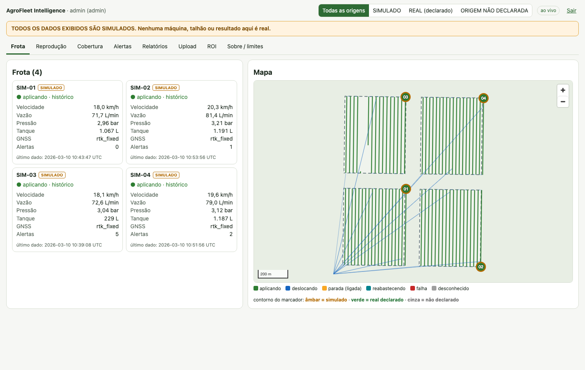
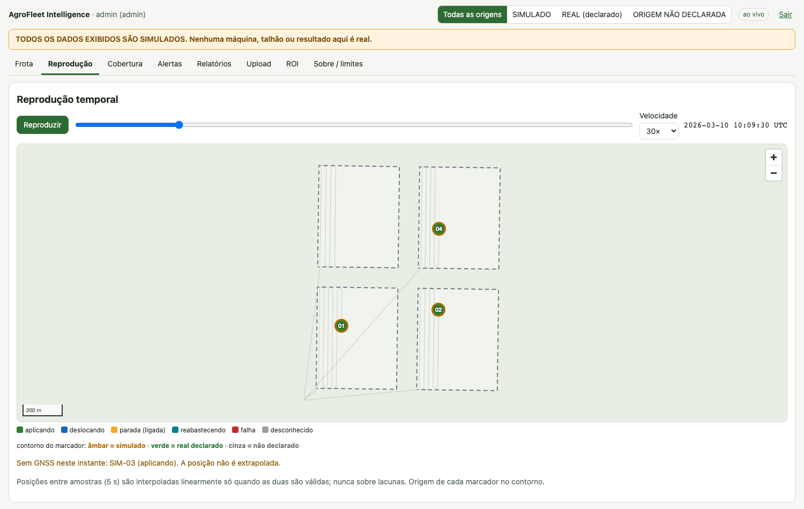
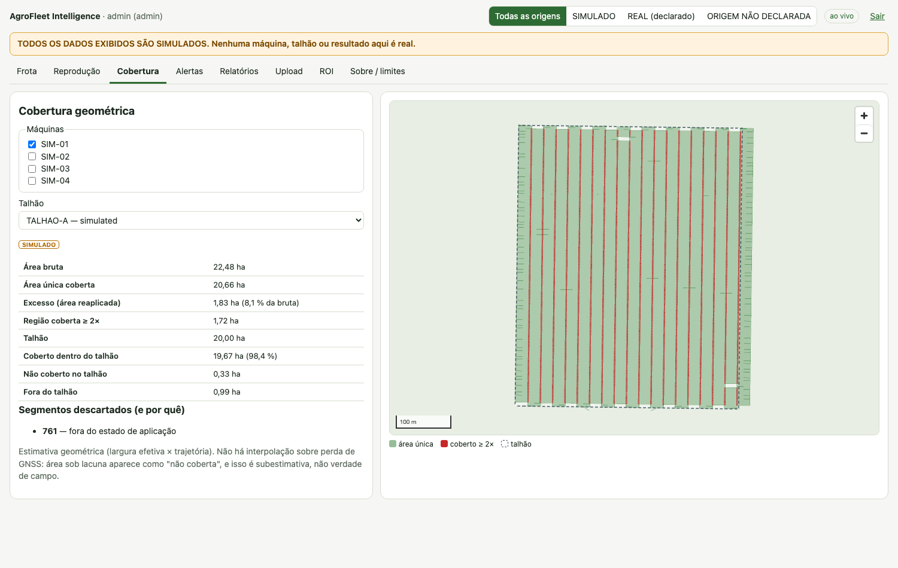
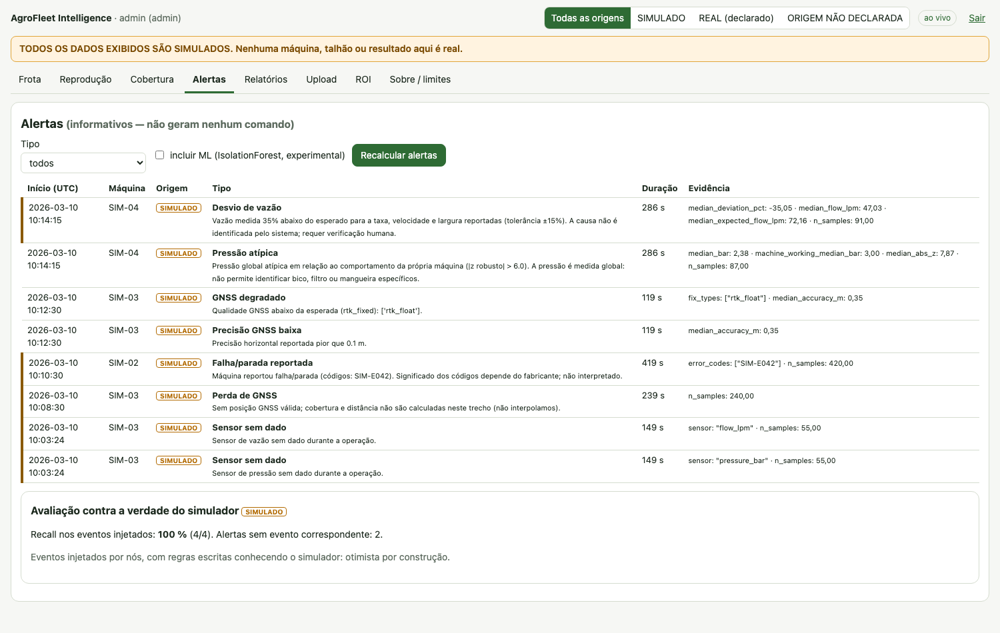
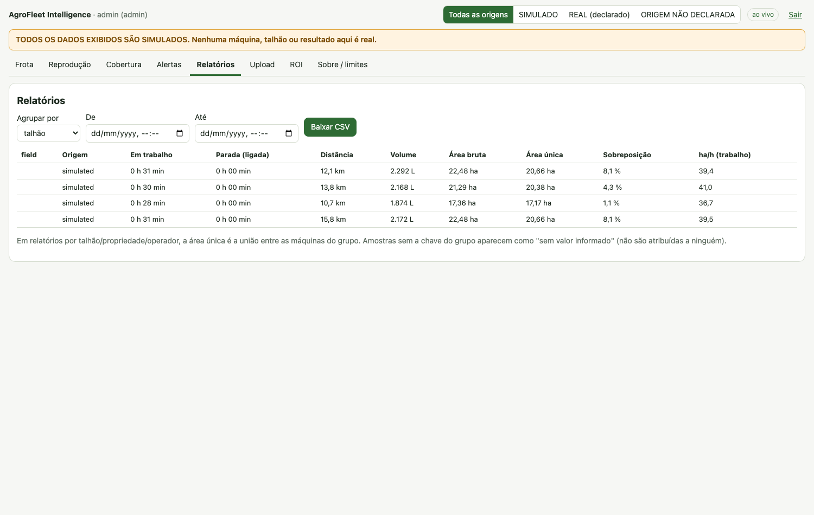
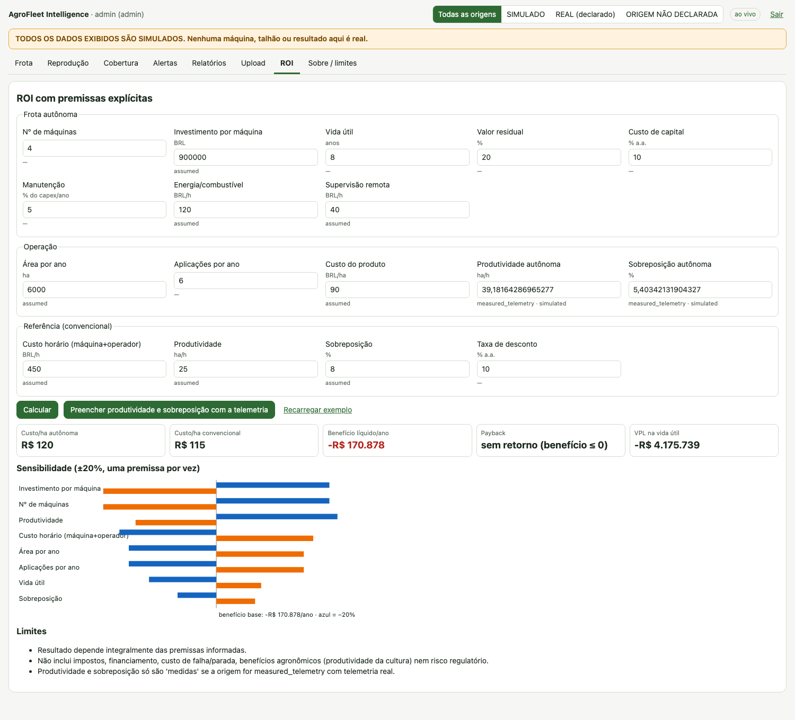

# AgroFleet Intelligence

**English** · [Português](README.md)

Telemetry, monitoring and auditing platform for agricultural machines, focused on autonomous ground sprayers. It ingests what the machine reports, validates and stores it, measures coverage and productivity, and raises informational alerts.

> **Scope and safety.** The system does not control steering, braking or spraying and generates no machine commands. Alerts are informational; critical decisions stay with certified systems and people.
>
> **Data.** Every number in this repository comes from a simulator (`origin = simulated`); no real machine telemetry was used. Simulated and real data are kept apart in the database, API and UI. ISOXML and manufacturer APIs are not implemented.

## Features

- Live fleet dashboard (WebSocket) with data-origin badges.
- Temporal playback without position extrapolation.
- Distance, time per state, idle time, area, ha/h and cost/ha.
- Gross, unique and overlap area; field coverage.
- Rule-based anomaly detection (only when the sensor exists) and experimental IsolationForest.
- Reports by machine, property, field, operator and period (JSON/CSV).
- CSV, JSON, GeoJSON and GPX upload with a quality report before saving.
- MQTT ingestion with a versioned schema (`agrofleet/v1`), authentication and ACL.
- Reproducible 4-sprayer simulator (normal operation, stop, GNSS loss, abnormal flow, missing data).
- ROI with configurable assumptions, tornado chart, break-even and provenance.
- REST API (OpenAPI), WebSocket and role-based authentication.

## User interface

| Fleet | Playback without GNSS | Coverage |
|---|---|---|
|  |  |  |

| Alerts | Reports | ROI |
|---|---|---|
|  |  |  |

Screenshots show simulated data. The interface text is in Portuguese.

## Architecture

```
Simulator / Device --MQTT--> Mosquitto (auth + ACL) --> Ingestion --> PostgreSQL + PostGIS
Files (CSV/JSON/GeoJSON/GPX) --upload + quality-------------------------^        |
                                                                                 v
                          Analytics (coverage, metrics, anomalies, ROI) --> FastAPI (REST + WebSocket) --> React/TS + MapLibre
```

There is no path from the system to the machine. Stack: Python 3.11, FastAPI, SQLAlchemy 2, PostgreSQL 16 + PostGIS 3.4, Mosquitto 2, pandas, numpy, scikit-learn, shapely, pyproj, React 18, TypeScript, Vite, MapLibre GL JS, Docker Compose. Details in the [technical guide](docs/GUIA_TECNICO.md#2-arquitetura) (Portuguese).

## Quick start

Requirements: Podman or Docker with compose (tested with Podman only).

```bash
cp .env.example .env            # replace every CHANGE_ME (compose refuses to start without them)
podman compose up -d --build    # or: docker compose up -d --build
podman compose --profile sim up -d simulator     # optional: publishes the SIMULATED fleet over MQTT
```

UI: `http://localhost:${HTTP_PORT:-8080}`. API and Swagger: `http://localhost:${HTTP_PORT:-8080}/api/docs`. After recreating `backend`, run `podman compose restart frontend`.

## Tests

Local requirements: Python 3.11 and Node 22.

```bash
python3 -m venv .venv && source .venv/bin/activate && pip install -r requirements-dev.txt
export PYTHONPATH=.
pytest                                                    # unit and API (no Docker)
(cd frontend && npm ci && npx tsc --noEmit && npx vitest run)
```

Infrastructure tests (`pytest -m infra`, real PostGIS and Mosquitto) and E2E tests (`pytest -m e2e`) are described in the [technical guide](docs/GUIA_TECNICO.md#46-testes).

## Repository structure

```
agrofleet/          core: schema, geo, quality, adapters/, analytics/, simulator/
backend/app/        FastAPI, database, authentication, live pipeline
frontend/           React + TypeScript + MapLibre GL JS
simulator/          generate.py and publish.py CLIs
infra/              Dockerfiles, nginx, Mosquitto
notebooks/          analysis notebooks (generated by build_*.py)
payload_examples/   accepted and rejected payload examples (tested)
sample_data/        generated simulated data (seed 7)
scripts/, experiments/   geodesic validation and its output
docs/               technical guide and images
tests/              pytest (unit, API, infra, E2E)
```

## Data and licenses

All versioned data (`sample_data/`, `payload_examples/`) is synthetic or fictitious; no third-party data is included. Dependencies keep their own licenses. See [section 12 of the technical guide](docs/GUIA_TECNICO.md#12-licenças-e-atribuições).

## Documentation

[Technical guide](docs/GUIA_TECNICO.md) (Portuguese): architecture, data sources, installation and reproduction, integration and API, methodology, validation and metrics, limitations, security and troubleshooting.

## License

GPL-3.0. See [LICENSE](LICENSE).
