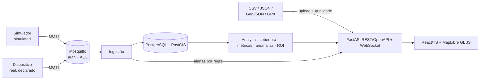

# AgroFleet Intelligence

[English](README.en.md) · **Português**

Telemetria, monitoramento e auditoria de máquinas agrícolas, com foco em **pulverizadores terrestres autônomos** (4+). Lê o que a máquina reporta, valida, armazena, mede cobertura e produtividade e emite **alertas informativos**.

> **Escopo e segurança.** O sistema **não controla** direção, freio nem aplicação e **não gera comandos** para máquinas. Alertas são informativos; decisões críticas permanecem com sistemas certificados e pessoas.
>
> **Honestidade dos dados.** Todos os números deste repositório vêm de um **simulador** (`origin = simulated`), nunca de máquina real. Dado simulado e real são separados em banco, API e interface. ISOXML e API de fabricante **não estão implementados** (sem amostra válida/documentação). Veja [Limitações](#limitações).

## Sumário
[Arquitetura](#arquitetura) · [Instalação](#instalação-e-execução) · [Demonstração](#demonstração) · [Resultados comprovados](#resultados-comprovados) · [Funcionalidades](#funcionalidades) · [Estrutura](#estrutura) · [Documentação](#documentação) · [Limitações](#limitações) · [Referências](#referências)

## Arquitetura



Não existe caminho do sistema para a máquina. Detalhes, diagramas de sequência, ER e segurança: [docs/pt-BR/04_arquitetura.md](docs/pt-BR/04_arquitetura.md).

Stack: Python 3.11, FastAPI, SQLAlchemy 2, PostgreSQL 16 + PostGIS 3.4, Mosquitto 2, pandas/numpy/scikit-learn/shapely/pyproj, React 18 + TypeScript + Vite + MapLibre GL JS, Docker Compose (portátil), pytest, Playwright.

## Instalação e execução

Requisitos: Podman (testado) ou Docker (**não testado**) com compose. Para os testes locais: Python 3.11 e Node 22.

```bash
cp .env.example .env            # TROQUE todos os CHANGE_ME (o compose recusa subir sem eles)
podman compose up -d --build    # ou: docker compose up -d --build
podman compose --profile sim up -d simulator     # opcional: publica a frota SIMULADA por MQTT
# interface: http://localhost:${HTTP_PORT:-8080}      API/Swagger: http://localhost:${HTTP_PORT:-8080}/api/docs
```

Notas operacionais: após recriar o `backend`, rode `podman compose restart frontend`; a imagem PostGIS é amd64 (emulada em Apple Silicon); o `.env` real está no `.gitignore` e **não** deve ser distribuído.

Ambiente de desenvolvimento e testes:

```bash
python3 -m venv .venv && source .venv/bin/activate && pip install -r requirements-dev.txt
export PYTHONPATH=.
pytest                                        # unitários + API (sem Docker)
(cd frontend && npm ci && npx tsc --noEmit && npx vitest run)
```

Testes de infraestrutura (PostGIS e Mosquitto reais) e E2E: [manual de integração §8](docs/pt-BR/manual_integracao.md).

## Demonstração

1. Suba a pilha e entre com um usuário do `.env` (papel `admin`).
2. Aba **Sobre / limites** → *Carregar demonstração SIMULADA* (ou rode o perfil `sim` para ver dados ao vivo).
3. Explore: **Frota**, **Reprodução** (a SIM-03 perde GNSS e some do mapa em vez de ser extrapolada), **Cobertura**, **Alertas**, **Relatórios**, **Upload** (com relatório de qualidade antes de gravar) e **ROI**.

| Frota | Reprodução sem GNSS | Cobertura |
|---|---|---|
|  |  |  |

| Alertas | Relatórios | ROI |
|---|---|---|
|  |  |  |

As imagens são capturas reais da interface (Playwright) exibindo **dados simulados**.

## Resultados comprovados

Todos executados nesta máquina (Podman, macOS arm64). Tudo vale **para dados simulados**; nada valida desempenho em máquina real.

**Testes**

| Suíte | Resultado |
|---|---|
| `pytest` (unitários, API, exemplos de payload, soluções dos exercícios) | **82 passaram** |
| `pytest -m infra` (PostGIS + Mosquitto reais) | **3 passaram** (3 execuções seguidas) |
| `pytest -m e2e` (Playwright/Chromium contra a pilha no ar) | **4 passaram** |
| `vitest` + `tsc --noEmit` (frontend) | **11 passaram**, sem erros de tipo |
| Notebooks (3), executados | **0 erros**, 0 placeholders |

**Medições** (simulador, semente 7; detalhes e ressalvas em [07](docs/pt-BR/07_validacao_metricas.md))

| Item | Resultado |
|---|---|
| Caso analítico (2 passadas, 495 m, barra 24 m, espaçamento 22 m) | bruta 23 760 m² · sobreposição 980 (esperado 990) · única 22 780 (esperado 22 770) |
| Erro da área única estimada, máquinas sem perda de GNSS | −1,6% a −1,8% (bruta −1,4%): viés de subestimação, causa não isolada |
| Erro com 4 min de perda de GNSS (SIM-03) | −15,8% (o método não interpola) |
| Sobreposição vs. largura efetiva ±5% | 8,1% → 3,7% / 12,2% |
| Sobreposição vs. ruído de posição σ = 0,5 / 1 / 2 m | 16% / 22% / 31% (verdade ≈ 8%) |
| Soma de tempo por estado = intervalo total | verificada nas 4 máquinas; falha SIM-02 = 0,117 h (7 min, como injetado) |
| Eventos injetados detectados pelas regras | 4/4 (**otimista**: regras escritas conhecendo o simulador; ver [06](docs/pt-BR/06_algoritmos_modelos.md) sobre o mapa `ACCEPT`) |
| Tolerância de vazão (sensor ruidoso σ = 8%) | 5% → ~1 600–2 200 falsos/h · 15–25% → 0 falsos e recall 1,0 · 35% → recall 0,16–0,52 |
| IsolationForest, `contamination` 0,01 → 0,15 | 0 → 30 alertas para 1 falha real (regra física: 3, todos na máquina certa) |
| PostGIS `geography` × `pyproj.Geod`, comprimento de trilha | diferença relativa ~1e-12 |
| Área de talhão UTM × geodésica | +0,11% neste local |
| Mosquitto em rajada de 3 600 mensagens QoS 1 | com padrão: 3 465 gravadas (perda); com `max_queued_messages 100000`: 3 600, 0 descartes |

## Funcionalidades

1. Dashboard da frota ao vivo (WebSocket) com selo de origem · 2. Reprodução temporal sem extrapolação · 3. Distância, tempo por estado, ociosidade, área, ha/h e custo/ha · 4. Área **bruta × única × sobreposição**, cobertura do talhão · 5. Detecção de anomalias por regra (só quando o sensor existe) + IsolationForest experimental · 6. Relatórios por máquina/propriedade/talhão/operador/período (JSON/CSV) · 7. Upload com validação de qualidade · 8. Simulador reprodutível de 4 pulverizadores (normal, parada, perda de GNSS, vazão anormal, dados faltantes) · 9. ROI com premissas configuráveis, tornado, grade, ponto de equilíbrio e proveniência · 10. OpenAPI + WebSocket + autenticação por papéis.

Adaptadores: CSV, JSON, GeoJSON, GPX, MQTT (schema versionado), simulador. **Não implementados:** ISOXML, API de fabricante.

## Estrutura

```
agrofleet/        núcleo: schema, geo, quality, adapters/, analytics/, simulator/
backend/app/      FastAPI, banco, auth, pipeline ao vivo     frontend/   React + TypeScript + MapLibre
simulator/        CLIs (generate.py, publish.py)             infra/      Dockerfiles, nginx, Mosquitto
notebooks/        3 notebooks executados                     tests/      pytest (unit, API, infra, E2E)
payload_examples/ exemplos aceitos e rejeitados (testados)   docs/pt-BR/ material didático e manuais
scripts/ experiments/  validação geodésica e sua saída real  sample_data/ dados SIMULADOS gerados
```

`adapters/`, `analytics/` e `simulator/` pedidos na especificação são subpacotes de `agrofleet/`.

## Documentação

[01 Visão geral](docs/pt-BR/01_visao_geral.md) · [02 Fundamentos](docs/pt-BR/02_fundamentos.md) · [03 Fontes de dados](docs/pt-BR/03_fontes_dados.md) · [04 Arquitetura](docs/pt-BR/04_arquitetura.md) · [05 Pipeline](docs/pt-BR/05_pipeline_passo_a_passo.md) · [06 Algoritmos](docs/pt-BR/06_algoritmos_modelos.md) · [07 Validação](docs/pt-BR/07_validacao_metricas.md) · [08 Interpretação](docs/pt-BR/08_interpretacao_resultados.md) · [09 Limitações](docs/pt-BR/09_limitacoes.md) · [10 Exercícios](docs/pt-BR/10_exercicios.md) · [11 Glossário](docs/pt-BR/11_glossario.md) · [12 Próximos passos](docs/pt-BR/12_proximos_passos.md) · [Manual do usuário](docs/pt-BR/manual_usuario.md) · [Manual de integração](docs/pt-BR/manual_integracao.md) · [Exemplos de payload](payload_examples/README.md)

Notebooks: `01_telemetria_simulador_e_qualidade`, `02_geometria_cobertura_e_metricas`, `03_series_anomalias_e_roi`.

## Limitações

Resumo (lista completa e medidas em [09](docs/pt-BR/09_limitacoes.md)):

- **Nenhuma telemetria real foi usada**; desempenho em campo é desconhecido. O simulador é idealizado (sem vento, relevo, falhas reais de bico).
- **ISOXML/TASKDATA e API de fabricante não implementados**; CAN/ISOBUS bruto não usado.
- **Não diagnostica bico entupido** (pressão global); alertas são indícios, não causas.
- Área estimada tem viés de −1,4 a −1,8% e é sensível à **largura efetiva** e ao **ruído de GNSS**; perda de GNSS reduz a cobertura estimada (não interpolamos).
- IsolationForest depende de `contamination`; no streaming só rodam regras.
- Fila de ingestão **em memória** (perda se o processo cair); sem teste de carga.
- Segurança básica: sem TLS no compose local, MFA/SSO, revogação de token ou rate limiting.
- **Docker Desktop não testado**; PostGIS amd64 emulado em arm64.
- Não é segurança funcional (ISO 13849/25119).

## Referências

ISO 11783 (ISOBUS), partes 10 e 11 · Snyder, *Map Projections — A Working Manual* (USGS PP 1395, 1987) · Karney, "Algorithms for geodesics", *J. Geodesy* 87 (2013) · Liu, Ting & Zhou, "Isolation Forest", IEEE ICDM (2008) · RFC 7946 (GeoJSON) · RFC 7519 (JWT) · MQTT 3.1.1/5.0 (OASIS) · GPX 1.1 · documentação de PostGIS, shapely, pyproj, FastAPI, MapLibre GL JS.

## Repositório, versionamento e execução em outra máquina

Código publicado a partir da máquina de desenvolvimento original (macOS, Podman). Isto **não** foi executado em GitHub Codespaces nem em Docker Desktop; se rodar lá, trate como primeira verificação e compare com a seção de testes.

- **Versionado:** tudo o necessário para subir a pilha e rodar os testes (`agrofleet/`, `backend/`, `frontend/`, `infra/`, `simulator/`, `sample_data/`, `payload_examples/`, notebooks executados, `docs/pt-BR/`). Não há dados externos.
- **Não versionado:** `.env` (copie de `.env.example` e troque os `CHANGE_ME`), `.venv/`, `node_modules/`.
- Testado só com **Podman**; Docker Desktop não. Veja *Limitações*.
- **Licença do código:** GPL-3.0 (arquivo `LICENSE`). Licenças e atribuições de dados/modelos de terceiros: veja as seções e docs indicados acima.
