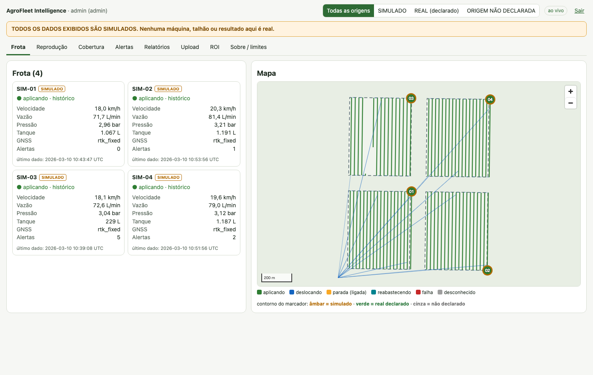
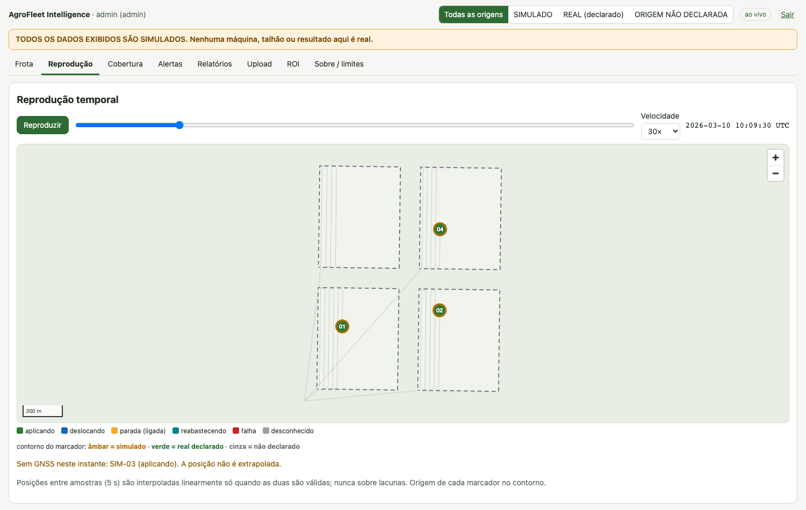
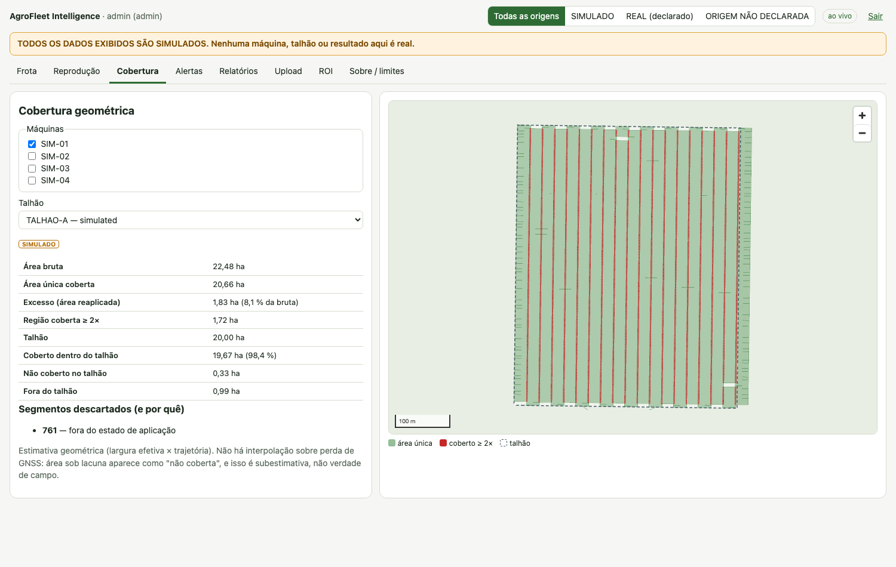
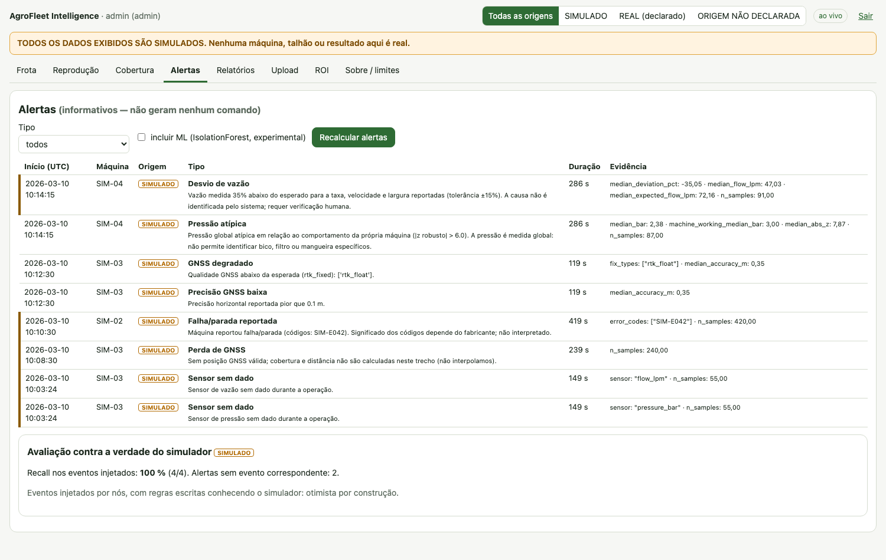
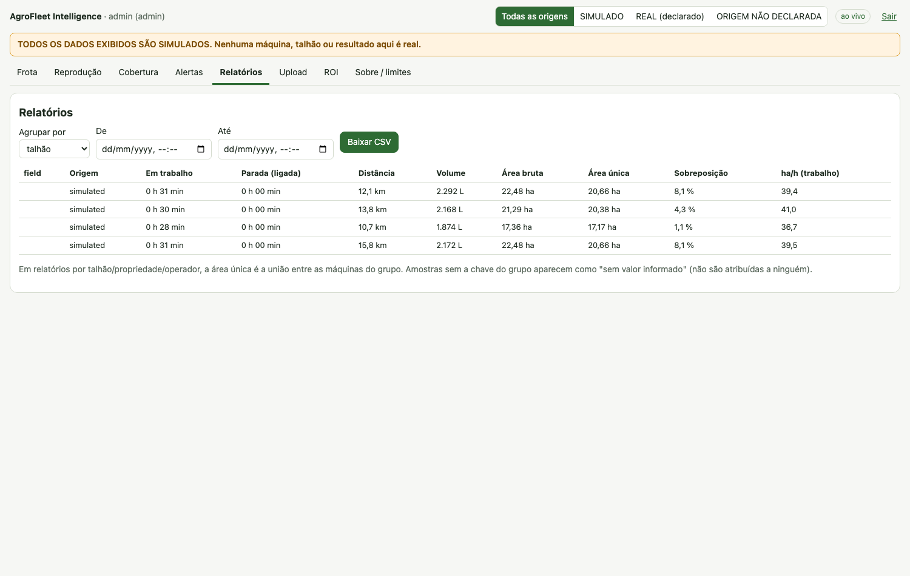
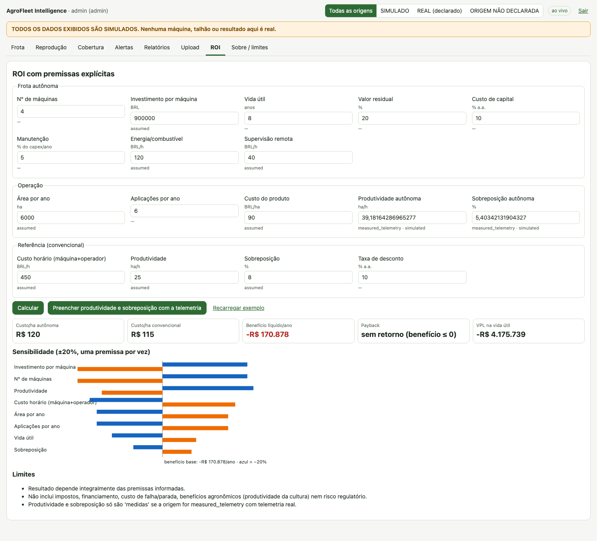

# AgroFleet Intelligence

[English](README.en.md) · **Português**

Plataforma de telemetria, monitoramento e auditoria de máquinas agrícolas, com foco em pulverizadores terrestres autônomos. Lê o que a máquina reporta, valida, armazena, mede cobertura e produtividade e emite alertas informativos.

> **Escopo e segurança.** O sistema não controla direção, freio nem aplicação e não gera comandos para máquinas. Alertas são informativos; decisões críticas permanecem com sistemas certificados e pessoas.
>
> **Dados.** Todos os números deste repositório vêm de um simulador (`origin = simulated`); nenhuma telemetria de máquina real foi usada. Dado simulado e real são separados no banco, na API e na interface. ISOXML e API de fabricante não estão implementados.

## Funcionalidades

- Painel da frota ao vivo (WebSocket) com selo de origem dos dados.
- Reprodução temporal sem extrapolação de posição.
- Distância, tempo por estado, ociosidade, área, ha/h e custo/ha.
- Área bruta, única e sobreposição; cobertura do talhão.
- Detecção de anomalias por regras (apenas quando o sensor existe) e IsolationForest experimental.
- Relatórios por máquina, propriedade, talhão, operador e período (JSON/CSV).
- Upload de CSV, JSON, GeoJSON e GPX com relatório de qualidade antes de gravar.
- Ingestão MQTT com schema versionado (`agrofleet/v1`), autenticação e ACL.
- Simulador reprodutível de 4 pulverizadores (operação normal, parada, perda de GNSS, vazão anormal, dados faltantes).
- ROI com premissas configuráveis, tornado, ponto de equilíbrio e proveniência.
- API REST (OpenAPI), WebSocket e autenticação por papéis.

## Interface

| Frota | Reprodução sem GNSS | Cobertura |
|---|---|---|
|  |  |  |

| Alertas | Relatórios | ROI |
|---|---|---|
|  |  |  |

As capturas exibem dados simulados.

## Arquitetura

```
Simulador / Dispositivo --MQTT--> Mosquitto (auth + ACL) --> Ingestão --> PostgreSQL + PostGIS
Arquivos (CSV/JSON/GeoJSON/GPX) --upload + qualidade-------------------^        |
                                                                                v
                              Analytics (cobertura, métricas, anomalias, ROI) --> FastAPI (REST + WebSocket) --> React/TS + MapLibre
```

Não existe caminho do sistema para a máquina. Stack: Python 3.11, FastAPI, SQLAlchemy 2, PostgreSQL 16 + PostGIS 3.4, Mosquitto 2, pandas, numpy, scikit-learn, shapely, pyproj, React 18, TypeScript, Vite, MapLibre GL JS, Docker Compose. Detalhes no [guia técnico](docs/GUIA_TECNICO.md#2-arquitetura).

## Início rápido

Requisitos: Podman ou Docker com compose (testado apenas com Podman).

```bash
cp .env.example .env            # troque todos os CHANGE_ME (o compose recusa subir sem eles)
podman compose up -d --build    # ou: docker compose up -d --build
podman compose --profile sim up -d simulator     # opcional: publica a frota SIMULADA por MQTT
```

Interface: `http://localhost:${HTTP_PORT:-8080}`. API e Swagger: `http://localhost:${HTTP_PORT:-8080}/api/docs`. Após recriar o `backend`, execute `podman compose restart frontend`.

## Testes

Requisitos locais: Python 3.11 e Node 22.

```bash
python3 -m venv .venv && source .venv/bin/activate && pip install -r requirements-dev.txt
export PYTHONPATH=.
pytest                                                    # unitários e API (sem Docker)
(cd frontend && npm ci && npx tsc --noEmit && npx vitest run)
```

Os testes de infraestrutura (`pytest -m infra`, PostGIS e Mosquitto reais) e E2E (`pytest -m e2e`) estão descritos no [guia técnico](docs/GUIA_TECNICO.md#46-testes).

## Estrutura do repositório

```
agrofleet/          núcleo: schema, geo, quality, adapters/, analytics/, simulator/
backend/app/        FastAPI, banco, autenticação, pipeline ao vivo
frontend/           React + TypeScript + MapLibre GL JS
simulator/          CLIs generate.py e publish.py
infra/              Dockerfiles, nginx, Mosquitto
notebooks/          notebooks de análise (gerados por build_*.py)
payload_examples/   exemplos de payload aceitos e rejeitados (testados)
sample_data/        dados simulados gerados (semente 7)
scripts/, experiments/   validação geodésica e sua saída
docs/               guia técnico e imagens
tests/              pytest (unitários, API, infra, E2E)
```

## Dados e licenças

Todos os dados versionados (`sample_data/`, `payload_examples/`) são sintéticos ou fictícios; não há dados de terceiros. Dependências mantêm suas próprias licenças. Ver [seção 12 do guia técnico](docs/GUIA_TECNICO.md#12-licenças-e-atribuições).

## Documentação

[Guia técnico](docs/GUIA_TECNICO.md): arquitetura, fontes de dados, instalação e reprodução, integração e API, metodologia, validação e métricas, limitações, segurança e solução de problemas.

## Licença

GPL-3.0. Ver [LICENSE](LICENSE).
