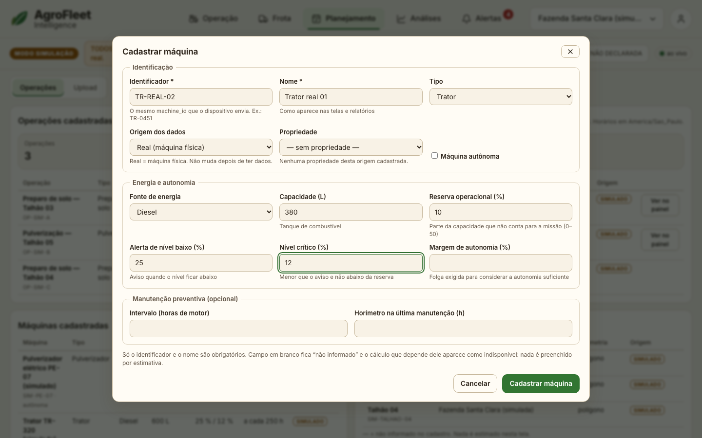
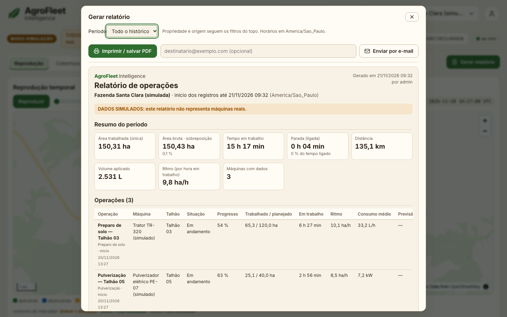

# AgroFleet Intelligence: guia do usuário

Este guia explica, passo a passo, como:
- usar a plataforma;
- cadastrar a sua fazenda e as suas máquinas;
- conectar a frota real;
- exportar relatórios.

Detalhes de arquitetura, cálculos e validação estão no [guia técnico](GUIA_TECNICO.md).

## Sumário

1. [O que a plataforma faz (e o que não faz)](#1-o-que-a-plataforma-faz-e-o-que-não-faz)
2. [Acesso, usuários e perfis](#2-acesso-usuários-e-perfis)
3. [Primeiros passos](#3-primeiros-passos)
4. [Painel Operação](#4-painel-operação)
5. [Outras seções](#5-outras-seções)
6. [Cadastrar fazenda, máquinas, talhões e operações](#6-cadastrar-fazenda-máquinas-talhões-e-operações)
7. [Conectar a frota real](#7-conectar-a-frota-real)
8. [Exportar relatórios e dados](#8-exportar-relatórios-e-dados)
9. [Clima e mapa](#9-clima-e-mapa)
10. [Problemas comuns](#10-problemas-comuns)

---

## 1. O que a plataforma faz (e o que não faz)

**Faz:**
- recebe a telemetria das máquinas (posição, velocidade, motor, combustível ou bateria, vazão etc.);
- mostra a situação de cada operação em tempo real;
- estima a área trabalhada, a previsão de conclusão e a autonomia;
- gera alertas;
- produz relatórios por máquina, talhão, propriedade ou operador.

**Não faz:**
- **Não envia comandos às máquinas.** É exclusivamente monitoramento. Não existe canal de comando, e uma mensagem que tente mandar um comando é rejeitada.
- **Não inventa leituras.** Quando um sensor não reporta, a tela mostra "—" com o motivo (por exemplo, "não reportado"), nunca 0.
- **Não decide sobre segurança.** Previsões e alertas são estimativas para apoiar a decisão de pessoas.

**Real ou simulado.** Todo dado tem uma origem declarada:

| Origem | Significado |
|---|---|
| `real` | quem enviou declarou que o dado veio de uma máquina real (o sistema não consegue comprovar) |
| `simulated` | dado do simulador ou de teste |
| `unknown` | origem não declarada |

Quando tudo o que está na tela é simulado, a barra abaixo do cabeçalho mostra **MODO SIMULAÇÃO**. Sobre os talhões simulados, o mapa ainda avisa: "Local fictício: o talhão simulado não corresponde à imagem de fundo".

---

## 2. Acesso, usuários e perfis

Abra o endereço informado pelo responsável pelo servidor (padrão `http://<servidor>:8080`) e entre com usuário e senha.

**Usuários.**
- Existem três perfis, criados pelo administrador do servidor no arquivo `.env`: `AGROFLEET_ADMIN_*`, `AGROFLEET_ANALYST_*` e `AGROFLEET_VIEWER_*`.
- Não existe usuário ou senha padrão: um perfil sem senha no `.env` simplesmente não é criado.
- Para trocar uma senha, altere o `.env` e reinicie o backend (`podman compose up -d backend`).

| Perfil | Pode |
|---|---|
| `viewer` (consulta) | ver todas as telas, relatórios e exportações |
| `analyst` (analista) | tudo do viewer + enviar arquivos de telemetria e contornos de talhão, cadastrar operações, recalcular alertas |
| `admin` (administrador) | tudo do analyst + cadastrar propriedades e máquinas, configurar alertas, carregar e apagar a demonstração |

A sessão expira depois de 8 horas (configurável em `AGROFLEET_TOKEN_TTL_S`).

---

## 3. Primeiros passos

### 3.1 Conhecer a tela

| Área | Para que serve |
|---|---|
| Cabeçalho | as cinco seções (**Operação, Frota, Planejamento, Análises, Alertas**); o sino mostra quantos alertas estão ativos |
| Seletor de fazenda | filtra as telas pela propriedade escolhida (fica salvo no navegador) |
| Menu da conta (ícone à direita) | seu usuário e perfil, **Tema** (claro, escuro ou automático), **Sobre / limites** e **Sair** |
| Barra de contexto | procedência dos dados, filtro de origem (Todas, Simulado, Real, Não declarada) e o estado da conexão ao vivo ("ao vivo", "conectando…", "sem conexão ao vivo") |

### 3.2 Experimentar com dados simulados

Antes de conectar a frota real, o administrador pode carregar uma demonstração:
1. Entre como `admin`.
2. Na seção **Operação** vazia, clique no botão para carregar os cenários simulados. Também dá para fazer isso em **menu da conta → Sobre / limites → Carregar demonstração SIMULADA**.
3. Explore as seções.
4. Para remover os dados de demonstração, use **Apagar dados simulados** em *Sobre / limites*. Os dados reais não são afetados.

Os cenários trazem um trator a diesel, um pulverizador elétrico (com autonomia insuficiente, para mostrar o alerta crítico) e um trator com falhas de conexão.

---

## 4. Painel Operação

É a tela principal. Mostra uma operação por vez: por padrão, a ativa mais recente da fazenda selecionada. Para trocar, use o seletor no card da máquina (canto superior direito).

### 4.1 Mapa (esquerda)

- **Mapa | Satélite:** alterna o mapa-base. A escolha fica salva.
- **Controles laterais:** aproximar, afastar, localizar a máquina, **camadas** (liga e desliga trajetória, área trabalhada, área pendente, fora do talhão) e tela cheia.
- **Desenho:**
  - contorno verde: limite do talhão;
  - verde claro: área já trabalhada;
  - linhas finas: passadas;
  - âmbar: área trabalhada fora do talhão.
- **Marcador:** posição da última amostra; a seta indica o rumo.

Abaixo do mapa, a **barra do talhão** traz o nome, a área, o progresso e o clima (seção 9).

### 4.2 Painéis (direita)

| Painel | Como ler |
|---|---|
| Máquina | Nome cadastrado, tipo de operação e estado. O ícone de sinal fica verde quando a máquina está conectada e vermelho quando não está. O **tempo de operação** só corre com a conexão ativa; sem conexão, mostra o tempo até o último dado |
| Velocidade, Rotação, Carga, Combustível / Bateria | Última leitura. Combustível em % e em litros (calculados pela capacidade do tanque cadastrada). Em máquina elétrica aparece a bateria em % e kWh. "não reportado" quando a máquina não envia o dado |
| Missão da Operação | Área trabalhada dentro do talhão sobre a área planejada |
| Previsão de conclusão | Horário estimado no fuso da fazenda (Hoje, Amanhã ou data), com uma faixa de variação. "Indeterminada" quando não há ritmo confiável; o motivo aparece logo abaixo (por exemplo, "Último dado há 16 min") |
| Autonomia e Conclusão | Autonomia estimada × tempo restante da missão. O bloco colorido resume: **suficiente** (verde), **apertada** (amarelo), **insuficiente** (vermelho), **indeterminado** (cinza) |
| Consumo / Produtividade | Médias da operação (L/h ou kW; ha/h) e as últimas parcelas de 10 minutos |
| Alertas | Alertas ativos desta operação, os críticos primeiro. Clique em um para abrir a seção Alertas filtrada pela máquina |

Nada disso é calculado no navegador: todos os valores vêm do servidor. O painel atualiza sozinho, a cada 15 s e sempre que chega dado novo.

> **Vermelho/crítico.** A severidade crítica representa risco operacional estimado, não uma decisão automática de segurança. O sistema permanece exclusivamente de monitoramento, sem comandos para máquinas.

---

## 5. Outras seções

| Seção | Subaba | O que você faz |
|---|---|---|
| **Frota** | — | Vê todas as máquinas: cartões com estado, última leitura e "ao vivo", e o mapa com a posição atual |
| **Planejamento** | Operações | Consulta operações, máquinas e talhões. O admin **cadastra e edita máquinas** por aqui (seção 6.2); operações, talhões e propriedades ainda são pela API (seção 6). "Ver no painel" abre a operação |
| | Upload | Envia arquivos de telemetria (seção 7.3) |
| **Análises** | Reprodução | Revê o histórico com um controle deslizante. Onde não houve posição (perda de GNSS), a máquina não é desenhada e a trilha é interrompida |
| | Cobertura | Calcula a área bruta, a única, a sobreposição (área aplicada duas vezes) e a cobertura do talhão para as máquinas escolhidas |
| | Relatórios | Gera e exporta relatórios em CSV (seção 8.2) |
| | botão **Gerar relatório** | Relatório do período para **imprimir, salvar em PDF ou enviar por e-mail** (seção 8.1) |
| | ROI | Simula o retorno do investimento com premissas editáveis; o botão de telemetria preenche premissas com dados medidos da frota |
| **Alertas** | — | Lista os alertas com severidade, duração, regra e evidências. O analista pode clicar em **Recalcular alertas** |

---

## 6. Cadastrar fazenda, máquinas, talhões e operações

O cadastro diz ao sistema **o que** cada máquina é (tanque, bateria, limites de alerta) e **o que** ela está fazendo (operação, talhão, área planejada). Sem ele, a telemetria ainda aparece na Frota, mas o painel Operação, a autonomia e a previsão de conclusão não funcionam.

> **Máquinas** se cadastram pela tela (Planejamento → Operações → **Cadastrar máquina**, seção 6.2). Propriedade, talhões e operações ainda são cadastrados **pela API**. A forma mais simples de usá-la é a página interativa em `http://<servidor>:8080/api/docs`: clique em **Authorize**, faça login e use **Try it out** em cada rota. Os exemplos abaixo usam `curl`.

**Preparação** (uma vez por sessão de terminal):

```bash
API=http://localhost:8080/api
TOKEN=$(curl -s $API/auth/login -H 'content-type: application/json' \
  -d '{"username":"admin","password":"SUA_SENHA"}' | python3 -c 'import sys,json;print(json.load(sys.stdin)["access_token"])')
AUTH="Authorization: Bearer $TOKEN"
```

Ordem recomendada: **1 propriedade → 2 máquinas → 3 talhões → 4 operação.**

### 6.1 Propriedade (admin)

```bash
curl -s -X PUT $API/registry/properties/FAZ-SANTA-CLARA -H "$AUTH" -H 'content-type: application/json' -d '{
  "property_id": "FAZ-SANTA-CLARA",
  "name": "Fazenda Santa Clara",
  "timezone": "America/Sao_Paulo",
  "ibge_municipality": "5206206",
  "origin": "real"
}'
```

- `timezone`: fuso usado para mostrar horários (o armazenamento é sempre UTC).
- `ibge_municipality`: código IBGE do município, com 7 dígitos (consulte em https://www.ibge.gov.br/explica/codigos-dos-municipios.php). É usado para o clima e é opcional.

### 6.2 Máquinas / veículos (admin)

**Pela tela (recomendado):**

1. Entre como **admin** e abra **Planejamento → Operações**.
2. No quadro **Máquinas cadastradas**, clique em **Cadastrar máquina**.
3. Preencha:
   - **Identificador:** precisa ser **exatamente** o `machine_id` que a máquina envia na telemetria.
   - **Nome:** como a máquina aparece nas telas e relatórios.
   - **Origem:** "Real (máquina física)" para máquinas de verdade.
   - **Propriedade:** só aparecem as da mesma origem.
4. Em **Energia e autonomia**, escolha a fonte (diesel ou elétrico). Informe a capacidade (L ou kWh) e, se quiser, a reserva, os limites de alerta e a margem de autonomia.
5. Clique em **Cadastrar máquina**.

Só o identificador e o nome são obrigatórios. O formulário aponta os erros antes de enviar, com as mesmas regras do servidor: nível crítico menor que o de aviso, manutenção com intervalo e horímetro juntos, e assim por diante.

Depois de salvar, a tela mostra **o tópico MQTT** em que o dispositivo da máquina deve publicar (seção 7.2). Para alterar uma máquina, use **Editar** na linha dela; o identificador e a origem não mudam na edição.



**Pela API** (para cadastrar muitas máquinas de uma vez ou integrar com outro sistema): uma chamada por máquina.

Trator a diesel:

```bash
curl -s -X PUT $API/registry/machines/TR-320 -H "$AUTH" -H 'content-type: application/json' -d '{
  "machine_id": "TR-320",
  "name": "Trator TR-320",
  "kind": "tractor",
  "energy_source": "diesel",
  "property_id": "FAZ-SANTA-CLARA",
  "origin": "real",
  "fuel_tank_capacity_l": 600,
  "energy_reserve_pct": 10,
  "energy_warning_pct": 25,
  "energy_critical_pct": 12,
  "autonomy_margin_pct": 15,
  "maintenance_interval_h": 250,
  "last_maintenance_engine_h": 4582
}'
```

Pulverizador elétrico: use `"kind": "sprayer"`, `"energy_source": "electric"` e `"battery_capacity_kwh": 60`, sem `fuel_tank_capacity_l`.

| Campo | Valores / unidade | Para que serve |
|---|---|---|
| `kind` | `tractor`, `sprayer`, `harvester`, `other` | tipo exibido |
| `energy_source` | `diesel`, `electric`, `unknown` | decide entre combustível e bateria |
| `fuel_tank_capacity_l` / `battery_capacity_kwh` | L / kWh | converte % em litros ou kWh e calcula a autonomia |
| `energy_reserve_pct` | % (0–50) | parte do tanque que não conta como disponível |
| `energy_warning_pct` / `energy_critical_pct` | % (crítico < aviso) | limites dos alertas de nível |
| `autonomy_margin_pct` | % | folga exigida para considerar a autonomia "suficiente" |
| `maintenance_interval_h` + `last_maintenance_engine_h` | h de motor | alerta de manutenção preventiva (só com os dois preenchidos) |

Os campos da tabela correspondem aos do formulário. Campos opcionais podem ser omitidos. Sem capacidade cadastrada, a autonomia aparece como "não calculada", com o motivo. A mesma chamada `PUT` atualiza uma máquina já cadastrada.

### 6.3 Talhões (analyst)

Envie um arquivo GeoJSON com os contornos (`Polygon` ou `MultiPolygon`, coordenadas em graus WGS84). Cada feição precisa de `properties.id`:

```json
{"type": "FeatureCollection", "features": [
  {"type": "Feature", "properties": {"id": "TALHAO-03"},
   "geometry": {"type": "Polygon", "coordinates": [[[-47.60, -16.70], [-47.59, -16.70], [-47.59, -16.69], [-47.60, -16.69], [-47.60, -16.70]]]}}
]}
```

```bash
curl -s $API/fields/upload -H "$AUTH" -F file=@talhoes.geojson -F origin=real -F property_id=FAZ-SANTA-CLARA
```

Contornos exportados de outros sistemas (KML, Shapefile) precisam ser convertidos para GeoJSON antes, por exemplo no QGIS: *Exportar → GeoJSON, EPSG:4326*.

### 6.4 Operação (analyst)

Uma operação liga **máquina + talhão + período**. É ela que alimenta o painel Operação.

```bash
curl -s -X PUT $API/operations/OP-2026-11-PREPARO-T03 -H "$AUTH" -H 'content-type: application/json' -d '{
  "operation_id": "OP-2026-11-PREPARO-T03",
  "name": "Preparo de solo — Talhão 03",
  "operation_type": "soil_preparation",
  "machine_id": "TR-320",
  "field_id": "TALHAO-03",
  "property_id": "FAZ-SANTA-CLARA",
  "implement_width_m": 12,
  "start": "2026-11-20T10:30:00Z",
  "status": "active",
  "origin": "real"
}'
```

- `operation_type`: `soil_preparation`, `planting`, `spraying`, `harvesting` ou `other`.
- `status`: `planned`, `active`, `completed` ou `cancelled`.
- `planned_area_ha`: área a trabalhar. Se omitido, vale a área do talhão.
- `implement_width_m`: largura do implemento, usada só quando a máquina não informa `working_width_m`.
- `start` e `end`: horários com fuso explícito (`Z` = UTC).

Ao terminar, envie de novo com `"status": "completed"` e `"end"` preenchido. Uma operação esquecida como "active" continua aparecendo no painel.

Confira tudo na tela em **Planejamento → Operações**.

---

## 7. Conectar a frota real

Há dois caminhos, que podem ser usados juntos:

| Caminho | Quando usar | Resultado |
|---|---|---|
| **MQTT (ao vivo)** | a máquina, ou um gateway no campo, tem conexão de dados | aparece no painel em segundos, com alertas ao vivo |
| **Arquivo (upload)** | dados baixados depois (pendrive, portal do fabricante, planilha) | entra no histórico, nos relatórios e nas análises |

> Importação direta de ISOXML/TASKDATA e de APIs de fabricantes **ainda não está disponível**. Para esses casos, converta os dados para CSV/JSON (7.3) ou use um gateway que publique em MQTT (7.2).

### 7.1 Antes de começar

1. Cadastre a propriedade, as máquinas, os talhões e a operação (seção 6).
2. Combine o `machine_id` de cada máquina: ele precisa ser idêntico no cadastro e na telemetria.
3. Garanta que o relógio dos equipamentos esteja certo, com fuso. Horário sem fuso é rejeitado.

### 7.2 Ao vivo por MQTT

A máquina, ou um gateway (computador de bordo, CLP ou módulo de telemetria que leia o barramento CAN/J1939 e o GNSS), publica uma mensagem por amostra, idealmente a cada 1 s.

**Conexão:**
- **Broker:** `<servidor>`, porta `1883` (`MQTT_PORT_HOST` no `.env`).
- **Usuário e senha:** `MQTT_DEVICE_USER` / `MQTT_DEVICE_PASSWORD`, informados pelo administrador. Esse usuário só pode publicar; não lê nada.
- **Tópico:** `agrofleet/v1/<machine_id>/telemetry`.
- **QoS:** 1.
- **Fora da rede local:** use TLS (porta 8883 com certificado; peça ao administrador). A porta 1883 sem TLS é só para teste em rede local.

**Mensagem** (JSON). O `machine_id` dos dados deve ser igual ao do tópico:

```json
{
  "schema_version": "1.1",
  "type": "telemetry",
  "message_id": "TR-320-000001",
  "sent_at": "2026-11-20T12:00:01Z",
  "data": {
    "machine_id": "TR-320",
    "ts": "2026-11-20T12:00:00Z",
    "origin": "real",
    "lat": -16.6923, "lon": -47.5653,
    "speed_ms": 2.08, "heading_deg": 37.5,
    "state": "working",
    "gnss_fix": "rtk_fixed", "accuracy_m": 0.03,
    "working_width_m": 12.0,
    "engine_rpm": 1950, "engine_load_pct": 78, "engine_hours_h": 4821.6,
    "fuel_level_pct": 62, "fuel_rate_lph": 25.4,
    "field_id": "TALHAO-03"
  }
}
```

**Campos e unidades** (todos opcionais, exceto `machine_id` e `ts`):

| Campo | Unidade / valores |
|---|---|
| `ts` | data e hora da leitura, com fuso |
| `lat`, `lon` | graus WGS84 (sempre os dois juntos; sem posição, omita os dois e envie `gnss_fix: "none"`) |
| `speed_ms` | m/s (km/h ÷ 3,6) |
| `heading_deg` | rumo, graus 0–360 |
| `state` | `working` (trabalhando), `transport`, `idle` (ligada parada), `refilling`, `fault`, `off`, `unknown` |
| `gnss_fix` / `accuracy_m` | `none`, `single`, `dgps`, `rtk_float`, `rtk_fixed` / precisão em m |
| `working_width_m` | largura de trabalho efetiva, m |
| `engine_rpm`, `engine_load_pct`, `engine_hours_h` | rpm, % (0–250), horímetro em h |
| `fuel_level_pct`, `fuel_rate_lph` | % do tanque, L/h |
| `battery_soc_pct`, `battery_energy_kwh`, `battery_power_kw` | %, kWh, kW (negativo = recarga) |
| `flow_lpm`, `pressure_bar`, `tank_level_l`, `application_rate_lha` | pulverização: L/min, bar, L de calda, L/ha |
| `field_id`, `operator_id`, `property_id` | identificadores para relatórios |

**Regras:**
- **Sensor sem leitura:** omita o campo ou envie `null`. **Nunca envie 0 para "não sei"**: o 0 é tratado como leitura real.
- **Campo desconhecido:** a mensagem inteira é rejeitada (isso impede, por exemplo, campos de comando).
- **Exemplos testados:** veja a pasta `payload_examples/` (`mqtt_envelope_v11_diesel.json`, `mqtt_envelope_v11_electric.json`).

**Teste rápido** com o cliente `mosquitto_pub`:

```bash
mosquitto_pub -h <servidor> -p 1883 -u device -P 'SENHA_DEVICE' -q 1 \
  -t agrofleet/v1/TR-320/telemetry -f mensagem.json
```

**Conferir se chegou:**
- a máquina aparece na **Frota** com "ao vivo";
- mensagens recusadas ficam em `GET $API/ingest/rejects` (perfil analyst), com o motivo;
- os contadores aparecem em `GET $API/health` (`mqtt.accepted`, `mqtt.rejected`).

### 7.3 Por arquivo (Planejamento → Upload)

Formatos aceitos: **CSV**, **JSON/NDJSON**, **GeoJSON** (trilha com horário em cada ponto) e **GPX**.

1. Entre como `analyst` ou `admin` e abra **Planejamento → Upload**.
2. Escolha o arquivo, o formato e a **origem** (marque `real` só para dados de máquina real).
3. Se os horários do arquivo não tiverem fuso, informe o fuso (por exemplo, `America/Sao_Paulo`). Sem isso, as linhas são recusadas.
4. Para GeoJSON e GPX, informe o `machine_id`.
5. Envie **sem gravar** primeiro. O relatório de qualidade mostra as linhas aceitas e as recusadas, cada uma com o motivo, além dos avisos de unidade.
6. Se estiver tudo certo, envie de novo marcando **gravar**. Reenviar o mesmo arquivo não duplica dados.

**Colunas reconhecidas no CSV**, com nomes em português ou inglês:
- `machine_id` (ou `maquina`, `machine`, `id`);
- `ts` (ou `timestamp`, `time`, `data_hora`);
- `lat`, `lon`;
- velocidade (`speed_ms` ou `speed_kmh`);
- `state`, `gnss_fix`, `flow`, `pressure`, `tank_level`, `width`;
- os campos de motor e energia.

Unidades diferentes das padrão (km/h, kPa, psi, gal/h, Wh, fração 0–1) podem ser declaradas no envio. O sufixo no nome da coluna (`speed_kmh`) também é entendido. Exemplos em `payload_examples/`.

---

## 8. Exportar relatórios e dados

### 8.1 Relatório para imprimir ou enviar (Análises → Gerar relatório)

1. Abra **Análises** e clique em **Gerar relatório**, no canto direito, em qualquer subaba.
2. Escolha o **Período**: hoje, últimos 7 ou 30 dias, este mês, todo o histórico ou personalizado (datas De/Até). Os dias são contados no fuso da propriedade. A **propriedade** e a **origem** seguem os filtros do topo da tela.
3. Confira a prévia. O relatório traz:
   - **Resumo do período:** área trabalhada única e bruta, sobreposição, horas em trabalho e paradas ligadas, distância, volume e ritmo.
   - **Operações:** situação, progresso, hectares trabalhados de planejados, ritmo, consumo médio e previsão de término.
   - **Máquinas.**
   - **Alertas**, por severidade.
   - Avisos de origem e de escopo. Dados simulados vêm marcados em destaque.
4. Escolha o que fazer:
   - **Imprimir / salvar PDF:** abre a janela de impressão do navegador. Para gerar o arquivo, escolha a impressora **Salvar como PDF**. Só o relatório é impresso, em fundo branco, no formato A4.
   - **Enviar por e-mail:** digite um ou mais endereços (separados por vírgula), ou deixe em branco. O seu programa de e-mail (Outlook, Gmail, Mail…) abre com o assunto e um resumo do relatório no corpo. Para enviar o relatório completo, **anexe o PDF** salvo no passo anterior. O e-mail sai da sua conta: a plataforma não envia e-mails sozinha nem usa serviço de e-mail pago.
   - **Compartilhar** (aparece no celular e em navegadores compatíveis): envia o resumo por WhatsApp, e-mail ou outro aplicativo do aparelho.

Com muitos dados (vários dias de várias máquinas), a geração pode levar alguns segundos; a tela avisa enquanto calcula.



### 8.2 Planilha CSV (Análises → Relatórios)

1. Escolha **Agrupar por**: máquina, propriedade, talhão ou operador.
2. Opcionalmente, defina o período (**De** / **Até**).
3. O filtro de origem da barra de contexto também vale: para um relatório só de dados reais, selecione **REAL (declarado)**.
4. Clique em **Baixar CSV**.

O arquivo `relatorio_<agrupamento>.csv` tem uma linha por grupo:

| Coluna | Significado |
|---|---|
| `origins` | origens dos dados do grupo (`real`, `simulated`…) |
| `n_samples` | número de amostras |
| `working_h`, `idle_h`, `engaged_h` | horas trabalhando, paradas ligadas e engajadas |
| `distance_km` | distância percorrida |
| `volume_l` | volume aplicado (pulverização; vazio se não houver vazão) |
| `gross_ha`, `unique_ha`, `excess_ha` | área bruta, única (sem contar duas vezes) e reaplicada |
| `overlap_pct_of_gross` | sobreposição em % da área bruta |
| `unique_ha_per_working_h` | produtividade, em ha por hora trabalhando |

**Para abrir no Excel:** o CSV usa vírgula como separador e ponto decimal. Abra em *Dados → De texto/CSV* e escolha o delimitador "Vírgula" e a localidade "Inglês (Estados Unidos)" para os números.

Amostras sem o campo do agrupamento (por exemplo, sem `operator_id`) aparecem em "sem valor informado"; não são atribuídas a ninguém.

### 8.3 Pela API (para planilhas, BI ou integrações)

Com o token da seção 6:

| O que | Chamada |
|---|---|
| Relatório em CSV | `curl -s "$API/reports?group_by=field&origin=real&start=2026-11-01T00:00:00Z&end=2026-11-30T23:59:59Z&format=csv" -H "$AUTH" -o relatorio.csv` |
| Relatório em JSON | o mesmo, com `format=json` (`group_by=total` dá uma linha só com os totais) |
| Relatório completo do período (o mesmo da seção 8.1) | `GET $API/reports/document?start=...&end=...&origin=real&property_id=FAZ-SANTA-CLARA` |
| Telemetria de uma máquina | `GET $API/machines/TR-320/telemetry?start=...&end=...` |
| Trilha (GeoJSON) | `GET $API/machines/TR-320/track` |
| Situação de uma operação | `GET $API/operations/<id>/status` (missão, autonomia, consumo, série de 10 min) |
| Geometria da operação | `GET $API/operations/<id>/geometry` (talhão, área trabalhada, pendente, trajetória em GeoJSON) |
| Alertas | `GET $API/alerts?status=active` (filtros `severity`, `operation_id`, `machine_id`) |
| Custos por hectare | `GET $API/metrics/TR-320?hourly_cost=350&product_cost_per_l=40` |

A lista completa de rotas, com teste interativo, está em `http://<servidor>:8080/api/docs`.

O PDF é gerado pelo navegador (seção 8.1); o relatório não inclui o mapa. Para apresentações com mapa, use a captura de tela, mantendo visível a atribuição do mapa (OpenFreeMap / EOX), como exigem as licenças.

---

## 9. Clima e mapa

**Clima** (barra do talhão):
- **Fonte:** INMET, com a observação da estação automática mais próxima e a previsão do município.
- **Detalhes:** passe o mouse sobre o bloco para ver a estação, a distância e o horário da leitura.
- **Observação × previsão:** quando não há observação, os números aparecem marcados como **previsão**.
- **Condição do céu:** só aparece quando o INMET a descreve.
- **Sem dados:** sem observação nem previsão (por exemplo, sem município cadastrado ou com o INMET fora do ar), aparece **Sem dados meteorológicos**.
- **Dados brutos:** os dados de estação do INMET não passam por validação do instituto e se referem ao ponto da estação, não ao talhão.

**Mapa:**
- **Provedores padrão:** mapa digital do OpenFreeMap e satélite Sentinel-2 de 2016 (EOX, 10 m por pixel). São gratuitos e permitem uso comercial.
- **Resolução:** a imagem de satélite mostra o talhão, mas sem detalhes finos.
- **Mapa-base fora do ar:** aparece o aviso "Mapa-base indisponível", e o talhão e a trajetória continuam sendo desenhados.
- **Privacidade:** ao carregar o mapa, o navegador contata esses servidores de mapas (seu IP fica visível para eles).

---

## 10. Problemas comuns

| Sintoma | Causa provável | O que fazer |
|---|---|---|
| Máquina não aparece na Frota | `machine_id` diferente do tópico; horário sem fuso; senha MQTT errada | ver `GET /ingest/rejects` e `GET /health` (`mqtt.rejected`) |
| Máquina aparece na Frota, mas o painel Operação está vazio | não há operação `active` para ela, ou a fazenda selecionada é outra | cadastrar a operação (6.4) e conferir o seletor de fazenda |
| Combustível em %, mas sem litros e sem autonomia | capacidade do tanque não cadastrada | preencher `fuel_tank_capacity_l` (6.2) |
| "Previsão de conclusão: Indeterminada" | pouco tempo de operação, máquina parada ou sem dado recente | o motivo aparece abaixo do valor; aguarde dados novos |
| Ícone de sinal vermelho, cronômetro parado | sem dado novo há mais de 5 min | verificar a conexão da máquina ou do gateway |
| "Sem dados meteorológicos" | propriedade sem `ibge_municipality`, estação a mais de 60 km ou INMET indisponível | cadastrar o código IBGE (6.1); o motivo aparece ao passar o mouse |
| Linhas recusadas no upload | horário sem fuso, posição (0,0), `lat` sem `lon`, valor negativo | o relatório de validação mostra o motivo de cada linha |
| Relatório mistura simulado e real | filtro de origem em "Todas" | selecionar **REAL (declarado)** antes de gerar |
| "Enviar por e-mail" não abre nada | o computador não tem um programa de e-mail padrão | defina um aplicativo de e-mail padrão no sistema, ou salve o PDF e anexe pelo webmail |
| Botão "Cadastrar máquina" não aparece | só o admin cadastra máquinas | entrar como admin |
| Máquina recém-cadastrada não aparece na lista | o filtro de origem ou de fazenda do topo mostra outra coisa | selecionar a origem certa ("Todas as origens") e a fazenda |
| Fui desconectado | a sessão expirou (8 h) | entrar de novo |

Dúvidas técnicas, instalação e configuração do servidor: [guia técnico](GUIA_TECNICO.md), seções 4 (instalação) e 13 (solução de problemas).
