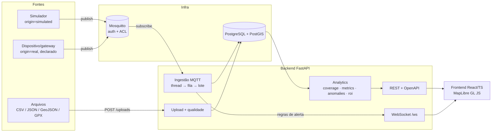
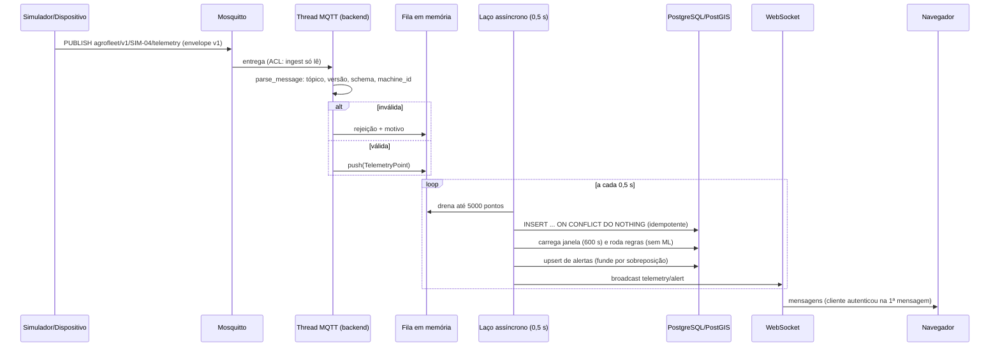
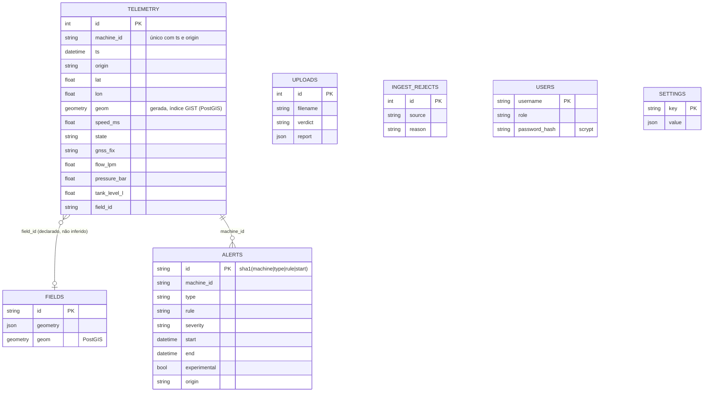
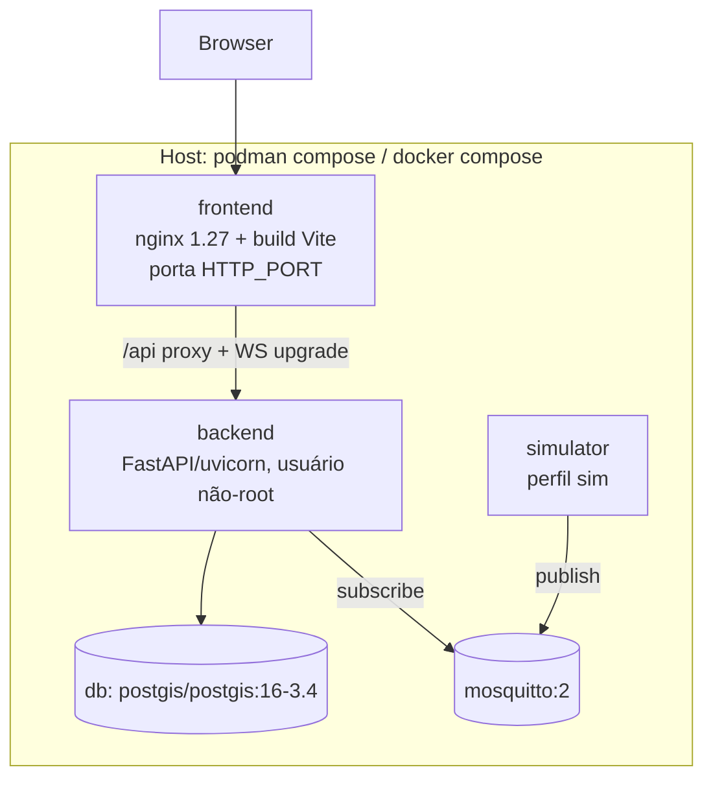

# 04 — Arquitetura

## 4.1 Visão de componentes

O sentido das setas importa para a segurança: **não existe seta do sistema para a máquina**.

## 4.2 Fluxo ao vivo (MQTT → tela)

## 4.3 Modelo de dados

A restrição de unicidade `(machine_id, ts, origin)` (`uq_tel_machine_ts_origin`) torna a inserção **idempotente**: reenviar o mesmo lote não duplica. Em PostgreSQL usamos `ON CONFLICT DO NOTHING ... RETURNING` para contar o que de fato entrou (o `rowcount` do driver não é confiável nesse caso — erro real que encontramos).

## 4.4 Implantação (Docker Compose, portátil)

- O compose **recusa subir** sem `POSTGRES_PASSWORD`, `MQTT_*_PASSWORD` e `AGROFLEET_AUTH_SECRET` (`:?` no YAML). Não há senha padrão.
- O `simulator` fica no perfil `sim` (`--profile sim`), então não polui a pilha por padrão.
- A imagem PostGIS oficial é **amd64**; em Apple Silicon roda emulada (mais lenta). Foi o que usamos aqui, via **Podman**. **Docker Desktop não foi testado.**
- Após recriar o `backend`, reinicie o `frontend` (o nginx resolve o endereço do backend na subida; senão devolve 502). Isso foi observado e é **parte do procedimento**.

## 4.5 Decisões de arquitetura (e alternativas)

| Decisão | Por quê | Alternativa | Trade-off |
|---|---|---|---|
| Geometria em Python/UTM, PostGIS como auditoria e filtro espacial | análises iterativas e testes sem banco; PostGIS valida | Fazer tudo em SQL (`ST_Union` sobre milhares de retângulos) | SQL escala melhor em dados enormes, mas é mais difícil de testar e iterar |
| SQLite nos testes, PostgreSQL em produção | testes rápidos e herméticos | Postgres em todos | tests de infra à parte (`-m infra`) cobrem as diferenças |
| Fila em memória no backend | simples | broker durável / consumidor separado | **perda de mensagens se o processo cair** (ver [09](09_limitacoes.md)) |
| Regras no streaming; ML sob demanda | regra é explicável e barata | ML no fluxo | ML sem rótulos gera muito alarme (notebook 03) |
| TimescaleDB **não** usado | volume do projeto não exige | hypertables | pode ser adotado depois; o modelo não depende dele |
| JWT HS256 + 3 papéis | suficiente para o escopo | OIDC/SSO | sem revogação nem MFA (ver abaixo) |

## 4.6 Segurança

**O que existe:**

- **Autenticação** JWT (HS256, TTL padrão 8 h, `AGROFLEET_TOKEN_TTL_S`), segredo ≥ 32 caracteres exigido pelo compose. Se `AGROFLEET_AUTH_SECRET` não existir, o backend gera um segredo aleatório **em memória** (os tokens não sobrevivem a reinício) e `GET /health` mostra `auth_secret_generated: true`; o compose nem sobe sem o segredo.
- **Papéis:** `viewer` < `analyst` < `admin`. `viewer` consulta; `analyst` faz upload, recomputa alertas e envia talhões; `admin` altera configuração, carrega demo e apaga dados.
- **Senhas:** hash **scrypt**. Usuário só é criado se a senha vier do ambiente (**sem senha padrão**).
- **WebSocket:** autentica na primeira mensagem (`{"type":"auth","token":...}`, 5 s); sem isso fecha com código 4401.
- **MQTT:** `allow_anonymous false`; dois usuários; **ACL**: dispositivo só escreve em `agrofleet/v1/+/telemetry`; backend só lê. Senhas e ACL são **geradas em runtime** a partir do ambiente (nada fixo na imagem).
- **Contêiner:** backend sem root. **TLS:** nunca desabilitamos verificação de certificado. O cliente MQTT aceita TLS com `tls_cafile`; o listener 8883 com certificados é a configuração recomendada para produção.

**O que não existe** (documentado como limitação): TLS ligado no compose local, MFA/SSO, revogação de token, limitação de taxa (*rate limiting*), auditoria de acesso, rotação automática de segredos, segurança funcional (ISO 13849/25119). Ver [09](09_limitacoes.md).

## 4.7 Contratos e documentação viva

- **OpenAPI/Swagger:** `GET /docs`, esquema em `/openapi.json` (tags: meta, auth, fleet, fields, analytics, alerts, ingest, demo, roi).
- **WebSocket:** `/ws`; mensagens servidor→cliente `hello`, `telemetry`, `alert`.
- Endpoints e exemplos de uso: [manual de integração](manual_integracao.md).
